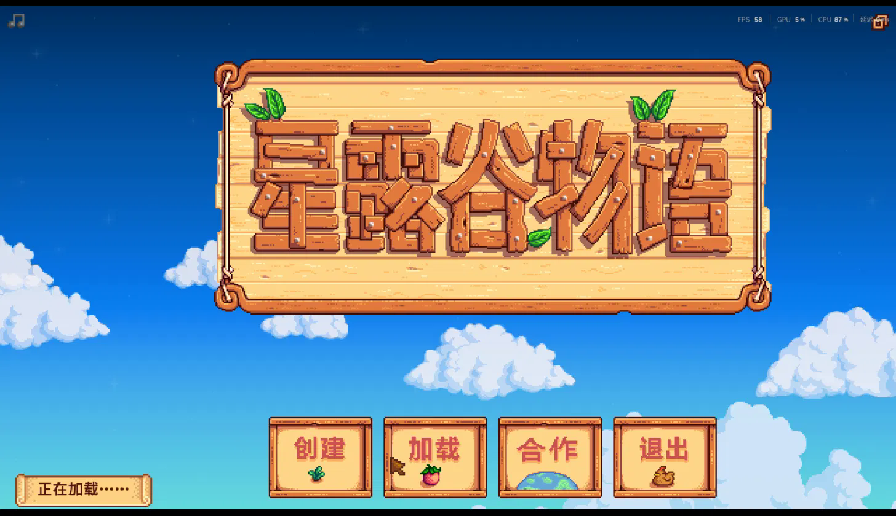
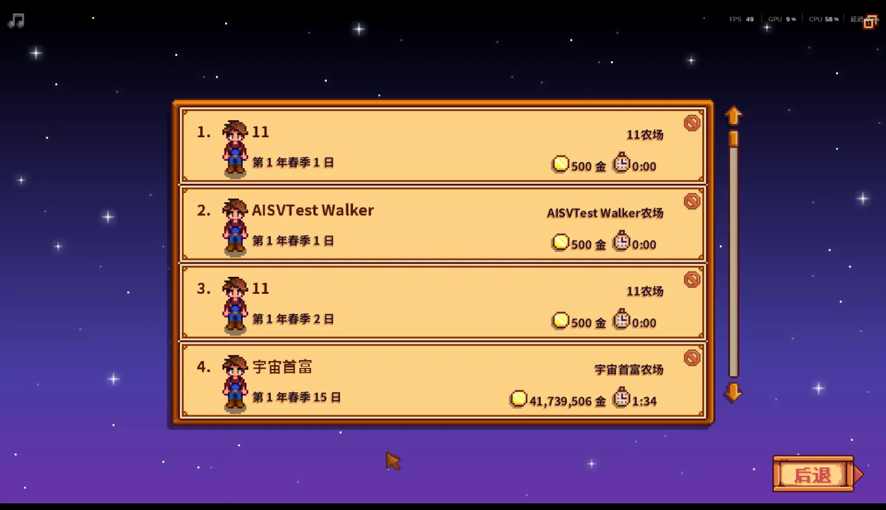
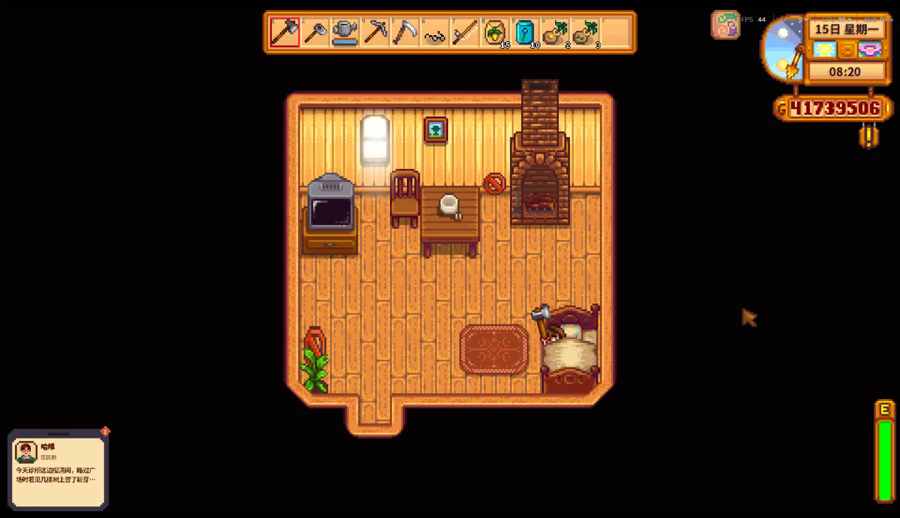
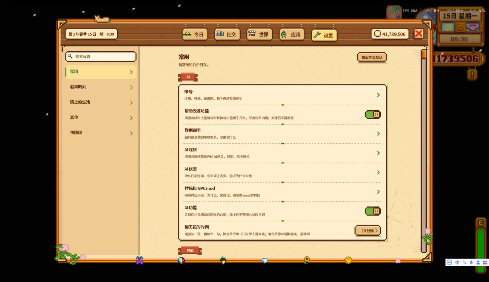
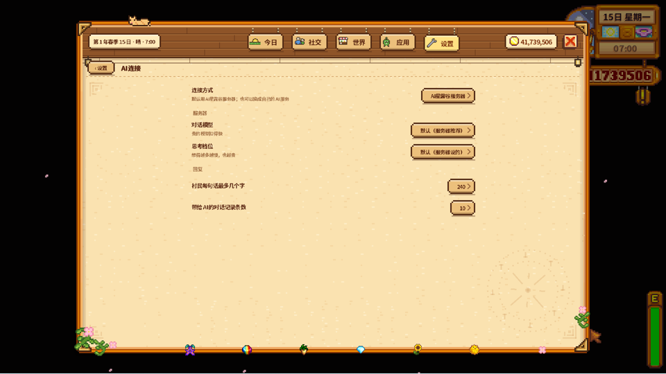
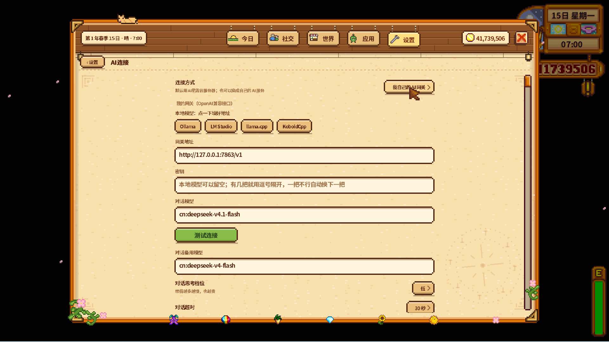
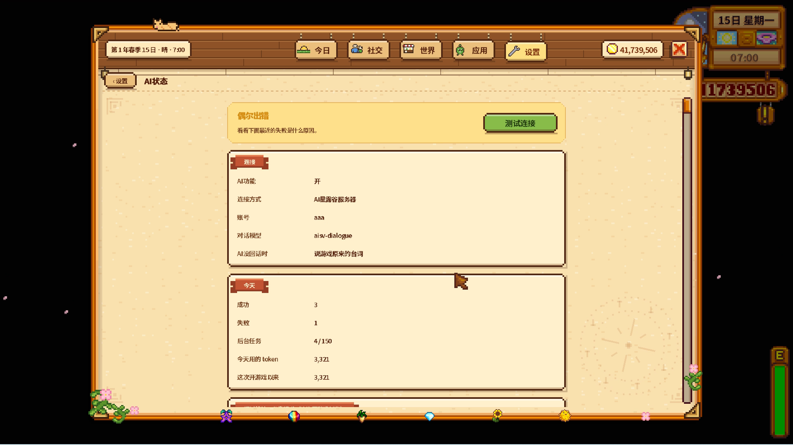

# 接入自己的 API

AI星露谷可以用你自己的 AI 服务，不必登录作者的服务器。接口要是 **OpenAI 兼容** 的 `/chat/completions`（DeepSeek、硅基流动、OpenRouter、Ollama、LM Studio、各种中转都行）。

准备三样东西：

1. **网关地址**
2. **密钥**（本地模型可以不填）
3. **模型名**（控制台里复制过来的那个）

---

## 1. 进存档

启动带 SMAPI 的星露谷，标题画面点 **加载**，选一个存档。外壳（设置）要进了存档才能打开。






---

## 2. 打开外壳

进游戏后按 **F9**。也可以打开背包，把手机拿在手上点一下。



顶栏切到 **设置**（扳手图标）。左边默认在 **常用**。



在「AI」那一组里点 **AI 连接**。旁边一行字写着：用服务器还是自己的 AI 网关、模型、思考档位。

---

## 3. 换成自己的网关

进来以后，默认是作者的服务器：



点右边的 **连接方式**，改成 **我自己的 AI 网关**。下面会出现地址、密钥、模型，还有一个绿色的「测试连接」。

自己编译、没有内置服务器的版本，进这个页面就直接是网关表单，没有这一步切换。



截图里的 `127.0.0.1:7863` 是本机中转的例子。用云端 API 就改成下表里的地址。

---

## 4. 填三项

### 网关地址

三种写法都行，mod 会自己补全：

| 你填的 | 实际请求 |
|---|---|
| `https://api.deepseek.com` | `…/v1/chat/completions` |
| `https://api.deepseek.com/v1` | `…/v1/chat/completions` |
| `https://api.deepseek.com/v1/chat/completions` | 原样用 |

本地模型点上面那一排按钮，会自动填地址：

| 按钮 | 填进去的地址 |
|---|---|
| Ollama | `http://127.0.0.1:11434/v1` |
| LM Studio | `http://127.0.0.1:1234/v1` |
| llama.cpp | `http://127.0.0.1:8080/v1` |
| KoboldCpp | `http://127.0.0.1:5001/v1` |

### 密钥

云端 API 把 `sk-…` 贴进去。本地模型可以留空。有几把备用 key 就用英文逗号隔开，一把不行会换下一把。

密钥在界面里是打码的，离开这一页会写进 `Mods/AIStardewValley/config.json`。

### 对话模型

填服务商控制台里的模型 ID，例如：

- DeepSeek：`deepseek-chat`
- OpenAI：`gpt-4o-mini`
- Ollama：你 `ollama list` 里的名字，比如 `llama3.1`
- 中转站：按它后台显示的名字填，有的带前缀（如 `cn:deepseek-v4.1-flash`）

---

## 5. 常见服务商

把「网关地址」和「对话模型」换成你自己的即可。

| 服务 | 网关地址 | 模型举例 |
|---|---|---|
| DeepSeek | `https://api.deepseek.com/v1` | `deepseek-chat` |
| OpenAI | `https://api.openai.com/v1` | `gpt-4o-mini` |
| 硅基流动 | `https://api.siliconflow.cn/v1` | 控制台里复制 |
| OpenRouter | `https://openrouter.ai/api/v1` | `openai/gpt-4o-mini` |
| 各类 New API / 中转 | `https://你的域名/v1` | 后台的模型名 |
| Ollama | `http://127.0.0.1:11434/v1` | `llama3.1` |
| LM Studio | `http://127.0.0.1:1234/v1` | 软件里加载的那个 |

密钥走 `Authorization: Bearer …`，和官方 Chat Completions 一样。

---

## 6. 测试连接

三项填好后点绿色的 **测试连接**。mod 会发一句很短的话（「只回一个字：好」）。

- 通了：绿色字，**通了，模型回了：…**
- 没通：红色字，原因会写在按钮下面；更细的在 SMAPI 日志里

测的时候按钮会变成「正在测试……」，等它结束。离开这一页，填过的内容会自动保存。

---

## 7. 到「AI 状态」确认

返回设置，点 **AI 状态**。



看这几项：

- **连接方式** 应是「自己的 AI 网关」
- **网关地址** 是你刚填的
- **密钥** 显示「已填」（不会把 key 明文亮出来）
- **对话模型** 是你填的模型名
- 上面的健康卡片变成「准备好了」或「一切正常」就行

这里也可以再点一次「测试连接」。

换成自己的网关之后，**不需要**再登录 AI星露谷账号。设置里的「账号」页会写：现在用的是自己的 AI 网关，不需要账号。

---

## 可选：备用模型和后台

同一页往下滚还有：

| 项 | 干什么 |
|---|---|
| 对话备用模型 | 主模型失败时按顺序换，逗号隔开，可以留空 |
| 对话思考档位 | 自动 / 不思考 / 低 / 中 / 高。想得越多越慢，也越贵 |
| 对话超时 | 默认 30 秒。本地大模型可以调到 90～180 |
| 后台模型 | 八卦、信件、晚上整理用的。留空就和对话模型一样 |
| 每天后台请求上限 | 只在自己的网关生效。`0` = 不限 |
| 回复的输出 token 上限 | 回答被截断时再调高 |
| 把 AI 收发的全文写进日志 | 排查问题时再开，里面有存档里的对话和八卦 |

对话模型和备用加在一起最多用 3 个。

---

## 常见问题

**连不上 / 网络错误**  
先看地址对不对、服务有没有开。本地模型要先启动 Ollama / LM Studio，再点「测试连接」。

**找不到模型**  
模型名必须和提供商后台完全一致，多一个空格都不行。

**key 不认 / 没权限**  
换一把，或看这个 key 能不能调这个模型。

**超时**  
把「对话超时」调长，或换更快的模型。思考档位先改成「不思考」或「低」。

**村民突然说游戏原来的台词**  
连续几次网关都失败时，会暂时改说原台词，大约一分钟后再试。去「AI 状态」看最近的失败原因。

**自己编译的版本没有「连接方式」**  
源码包没有 `assets/connection.dat`，只能填自己的网关，这是正常的。

也可以直接改 `Mods/AIStardewValley/config.json`：

```json
"AiConnectionMode": "own",
"CustomLlmBaseUrl": "https://api.deepseek.com/v1",
"CustomLlmApiKey": "sk-你的密钥",
"CustomLlmModel": "deepseek-chat"
```

改完最好重启一次游戏。优先还是在游戏里填，可以当场测试。
