# AI星露谷 新功能指南

这一版加了不少新玩法。下面一个个说清楚：怎么触发、怎么操作、会发生什么、不想要时怎么关。

游戏里也能查：打开手机 → **使用帮助**，每个玩法都写在里面。第一次碰到某个新玩法时，屏幕左下角只弹一行提示，不会打断你。

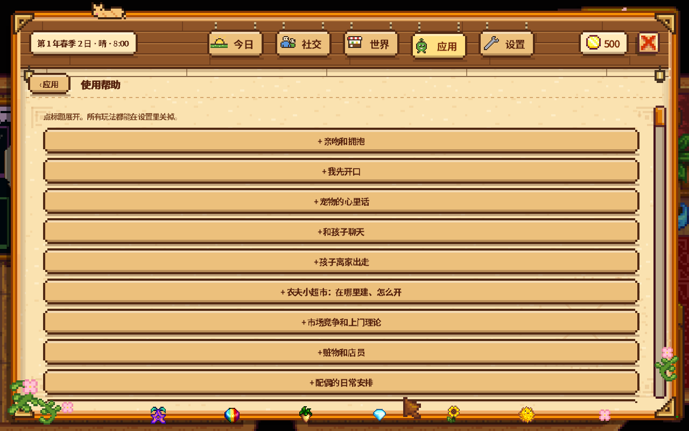

目录：

1. [农夫小超市](#一农夫小超市)
2. [亲吻还是聊天](#二亲吻还是聊天)
3. [我先开口](#三我先开口)
4. [宠物的心里话](#四宠物的心里话)
5. [和孩子聊天](#五和孩子聊天)
6. [孩子离家出走](#六孩子离家出走)
7. [配偶的一天](#七配偶的一天)
8. [常见问题和开关一览](#八常见问题和开关一览)

---

## 一、农夫小超市

在农场上开一间自己的小店，把收成、配偶做的东西、进来的货卖给镇上的人。店里的样子照着皮埃尔杂货店做，用的都是你游戏里原有的图。

### 1. 在哪里建

1. 去 **Robin 的木匠铺**：镇子北边、山脚下的木屋。
2. 点柜台 → **建造农场建筑**，用左右箭头翻到 **农夫小超市**。要 15000g、木材 300、石头 200，两天建好。

   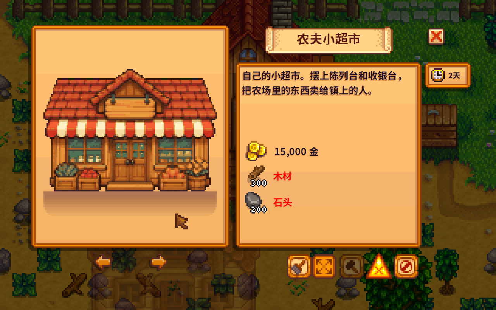

3. 在农场上挑一块空地放下，和放鸡舍一样。
4. 建好以后从正面的门进店（下图红圈）。

   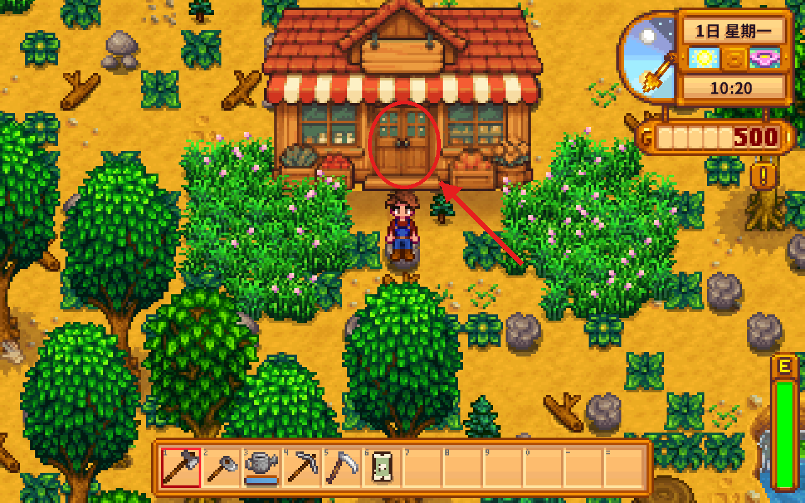

> 装了 Farmer's Store（农夫商店）也没关系：那是另一家店，两家可以同时开，不抢顾客。

### 2. 店里有什么

一进门就摆好了：

- 左上角是柜台和收银机。
- 两张白色大货架、一个玻璃冷柜、一个木柜、一个促销桶。
- 右下角的大箱子是库房：进来的货先放在这里。

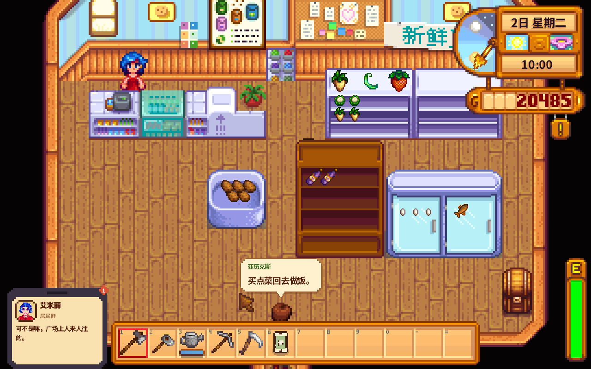

想要更多货架，去 Robin 店里买（在家具列表最后面）：

| 货架 | 放什么 | 特点 |
|---|---|---|
| 大货架 / 小货架 | 大部分东西 | 6 格 / 4 格 |
| 玻璃冷柜 | 鱼、蛋奶、果蔬、花、加工品、熟食 | 冷藏，鱼和蛋奶坏得慢 |
| 保温柜 | 只放熟食 | 熟食放这里更新鲜 |
| 促销桶 | 一样蔬果、野货、矿石或花，放很多 | 最显眼，顾客更容易拿 |
| 木柜 | 加工品、矿石、文物、花 | 适合放贵东西 |

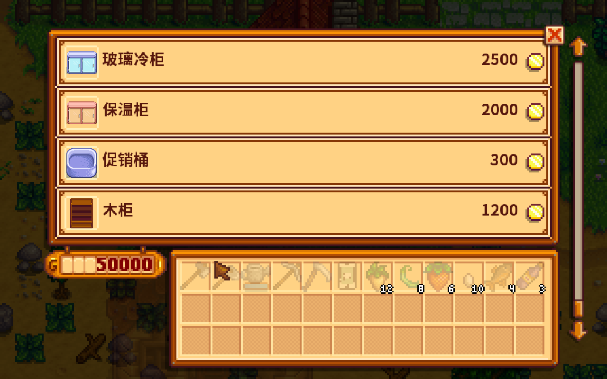

### 3. 上架和定价

- **拿着东西点货架**：直接放上去。
- **空手点货架**：打开货架窗口。下面是你的背包，左键点一样东西整组上架，右键只放一个。
- **点上面的格子**：可以降价 10%、涨价 10%、取下，或者让整个货架都按这个价。
- 每个格子上写着新鲜度和价格。放不进这个货架的东西会是灰的。

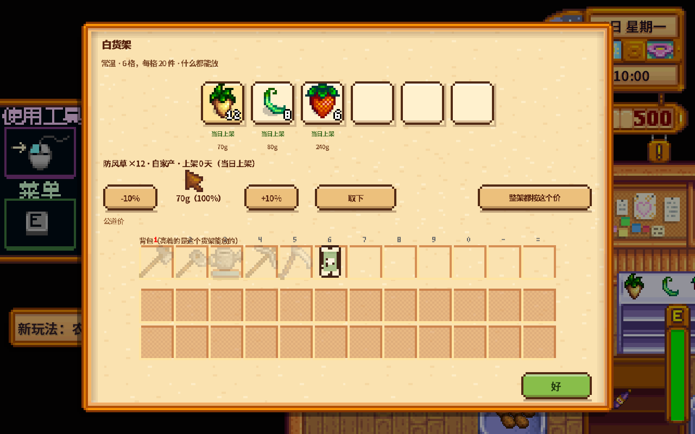

**新鲜度**：货从上架那天开始算，依次是当日上架、新鲜、正常、临期、过期。过期的基本没人买，还会招来差评。鱼放常温货架一天就不新鲜了，放冷柜能放好几天。矿石、加工品、文物不会坏。

**价格**：默认按今天的行情定。定得太高顾客嫌贵，会少买、打低分；定低一点卖得快，口碑也好。

### 4. 顾客来了：收银小游戏

营业时间默认 9:00～17:00，设置里可以改。你在店里时，村民会进门、在货架前挑东西、到柜台排队。

顾客也分几种：随便看看的、买菜做饭的、买水果的、买鱼的、买礼物的、肚子饿的、讲究品质的、收藏家。每人按自己的习惯和预算挑货。

有人排队时，**点柜台**开始收银：

1. 把篮子里的东西一样样点一下扫进袋子（也可以按空格）。

   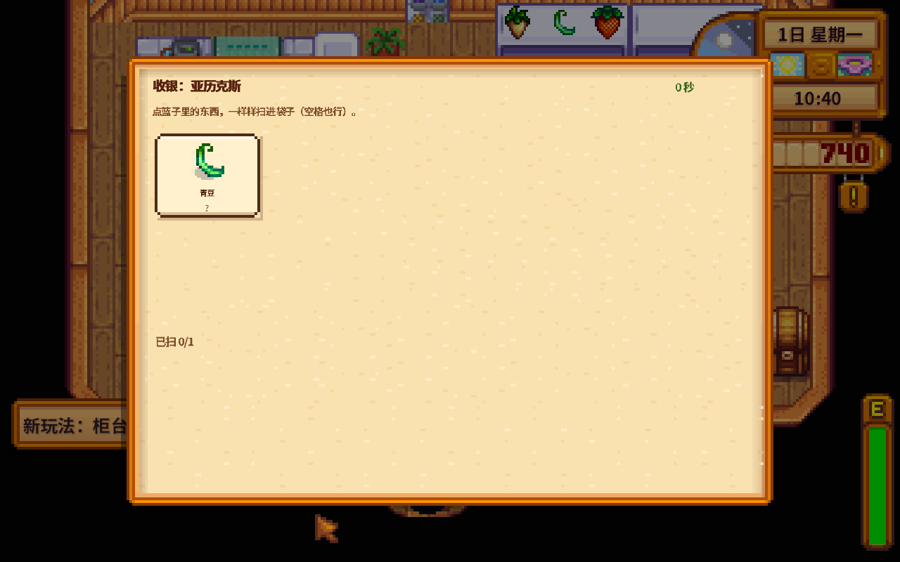

2. 屏幕上写着合计和顾客递来多少钱。用下面的硬币凑出该找的零钱，点 **找零**（刚好不用找就点 **刚好，收下**）。点错了点 **退一枚**。

   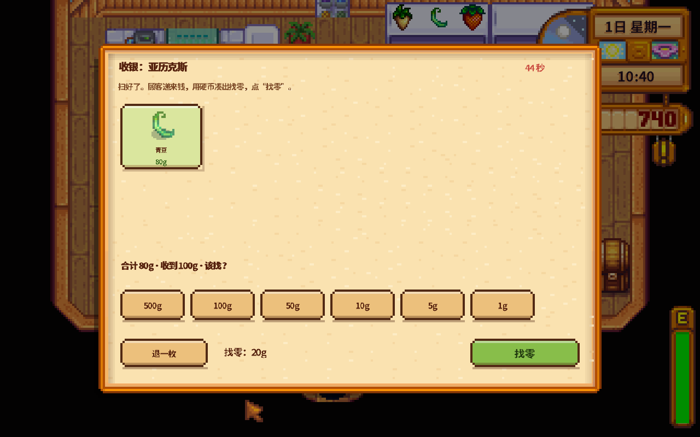

3. 又对又快有小费（10 秒内一成，20 秒内半成）；找错了顾客会不高兴，评价扣分。

   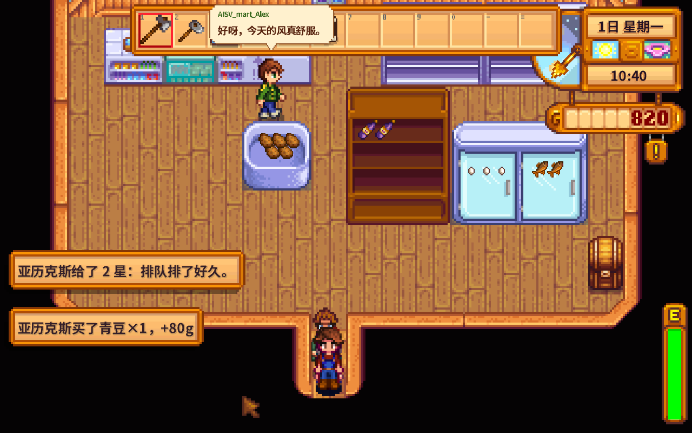

- 按 Esc 可以先不收，顾客接着排队。等太久没人收银，顾客会放下东西走掉。
- 雇了收银员，或者配偶在看店时，会自动结账。
- 不想玩小游戏：**设置 → 小超市 → 收银小游戏** 关掉，改成自动结账。
- 你不在店里时也照样卖，钱进钱箱，回店里点柜台取出。

### 5. 手机里的“小超市”应用

打开手机 → **小超市**，上面一排页签：

- **概况**：今天的营业额、星级、店铺等级、近 7 天的走势、今天的行情（一类热门、一类冷门）、每个货架上还剩多少。这里也能选 **店型**（杂货、蔬果、鱼铺、花店、熟食、工坊、古董），每周能换一次，对口的货卖得更好。

  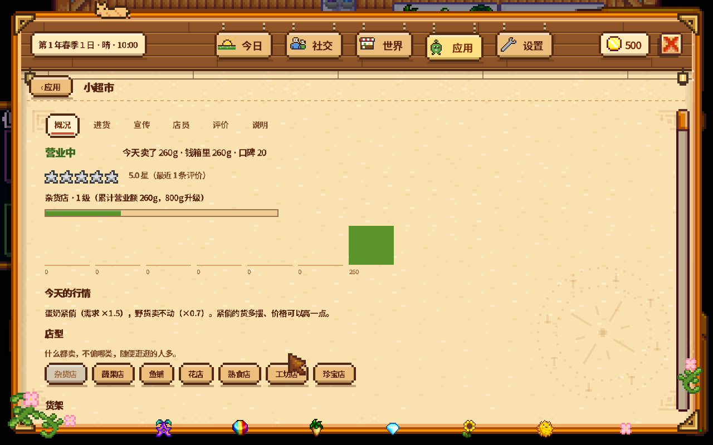

- **进货**：向 Pierre、Marnie、Willy、Gus、Clint、Evelyn 订货，每家按季节卖不同的东西。钱当场扣，第二天早上送到库房大箱子。点概况里的 **理货** 或者雇理货员，就会从库房搬上货架。从 Pierre 进货，他的生意也会好一点。

  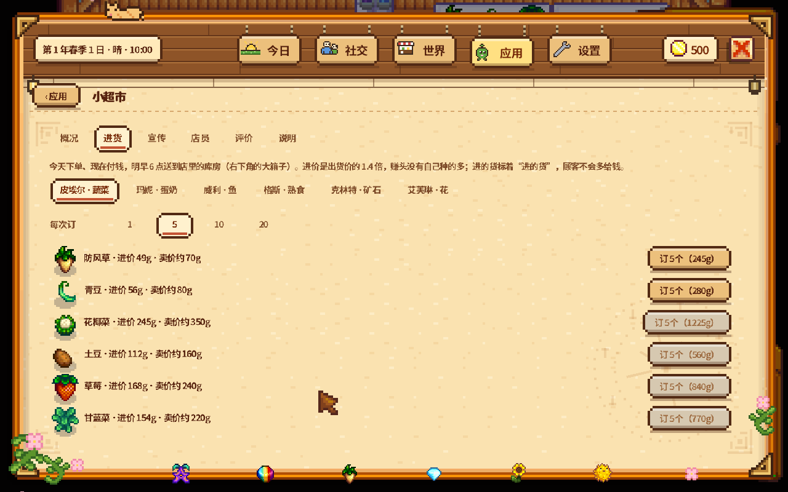

- **宣传**：贴海报（选一类货，7 天内这类货更好卖，店墙上会挂横幅）、选一样货放橱窗、吆喝一声（马上多来几位客人）。

  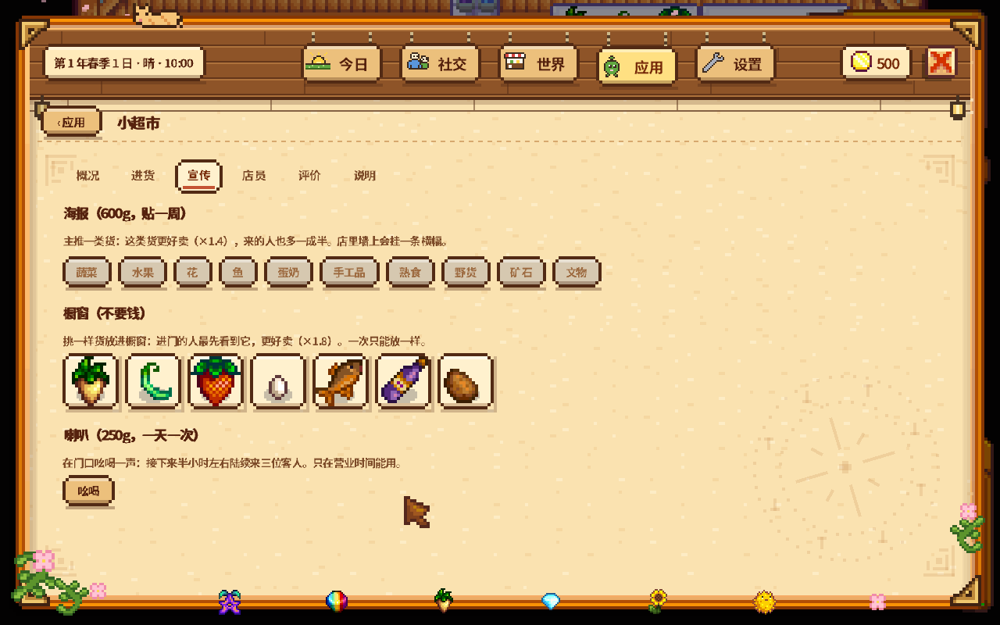
  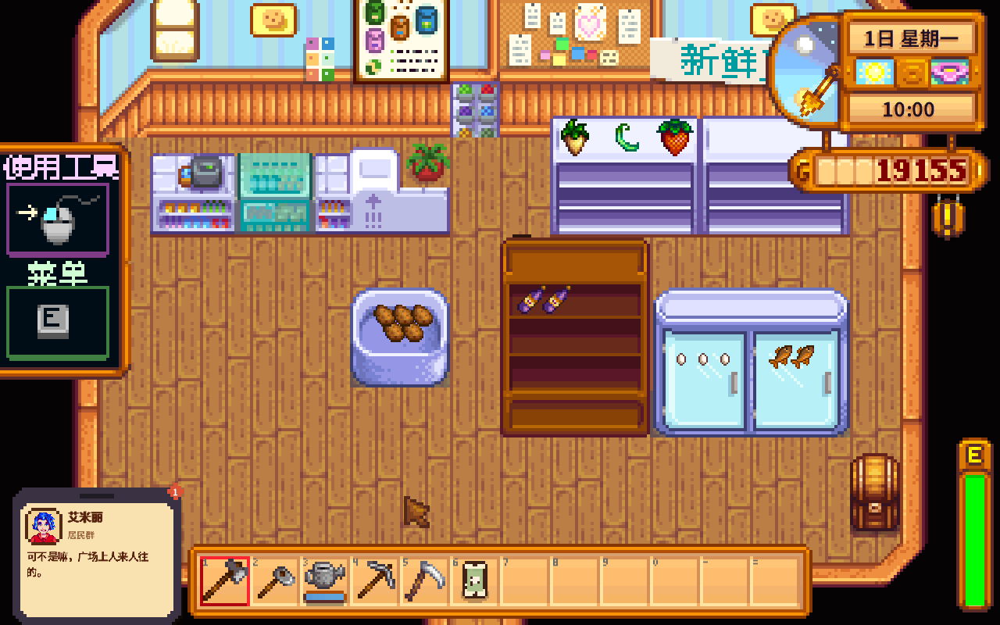

- **店员**：雇村民当收银员、理货员或迎宾，签 7 天或 28 天。和你越熟工资越低；Joja 生意不好时 Sam、Shane 更愿意来。最多 3 个人。

  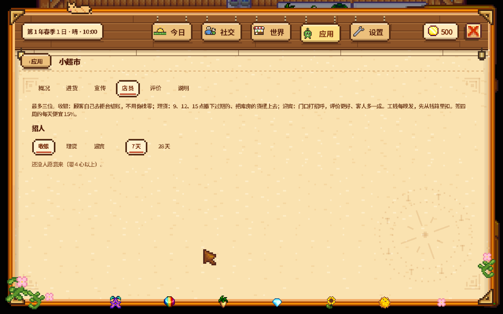

- **评价**：每位顾客离开时打一到五星，写一句为什么。找不到想要的、太贵、不新鲜、排队太久都会扣分；店里摆得漂亮、有人迎宾会加分。星级越高，来的人越多。

  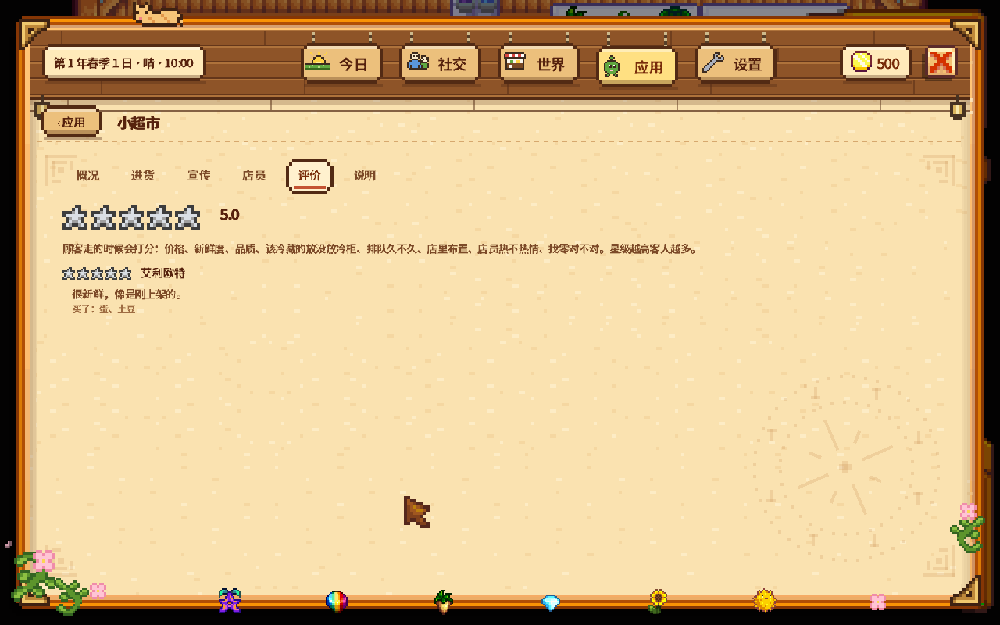

### 6. 和 Pierre、Joja 抢生意

- 你卖得越好，Pierre 和 Joja 的生意越差：吃紧、亏损，严重时停业整顿，营业时间会缩短。这只发生在 AI星露谷 自己的经济里，不改原版剧情，**种子一定买得到**。社区中心修好以后 Joja 就不参与了。
- 他们亏损以后，可能冲进你的店里理论。你可以讲道理、让一步（一周内涨价或停卖一类货），或者动手。动手就像原版剧情里那样给对方一拳，对方踉跄着退几步、晃一晃，然后气呼呼地走出门，不会受伤；但对方好感下降，镇长会罚款并寄信，周报上也会写。
- 不想有动手这个选项：**设置 → 小超市 → 上门理论时可以动手** 关掉。不想抢生意：同一页的 **和 Pierre、Joja 抢生意** 关掉。

### 7. 别卖赃物

偷来的东西放在店里卖，失主或者失主的家人、好朋友来买时可能认出来：好感下降，东西被拿走，镇上会传开。

### 8. 不想玩了 / 卸载前

- 只想关掉：**设置 → 小超市 → 农夫小超市** 关掉。
- 要删掉 mod：先在 SMAPI 控制台（游戏旁边的黑窗口）输入 `aisv_store uninstall` 回车。货架上和库房里的货都会收回背包（放不下的装进一个箱子，放在农场空地上），店变成原版的大棚屋，货架会拿掉。然后存档，再删 mod。

---

## 二、亲吻还是聊天

婚后点配偶时，如果今天还能亲（室友是拥抱），配偶头顶会弹出一个小圆盘：一边是聊天，一边是亲吻。

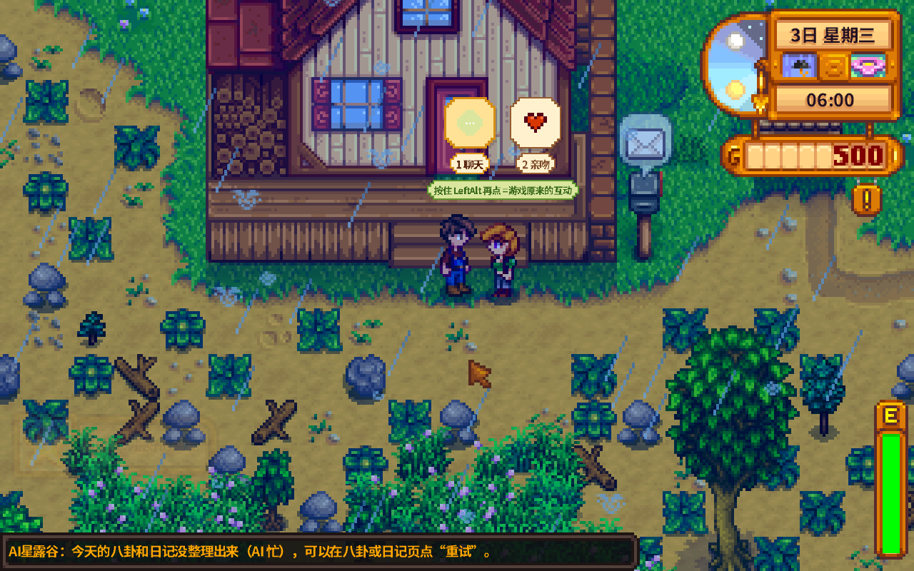

- 选亲吻：和游戏原来的亲吻一样，每天第一次加好感。
- 选聊天：进入 AI 对话。
- 按住 **Alt**（手柄按住 **LB**）点配偶，或者点任何村民，都是游戏原来的互动，跳过 AI。
- 不想要圆盘：**设置 → 家里 → 配偶 → 点配偶先选聊天还是亲吻** 关掉，点配偶就直接聊天。

## 三、我先开口

平时点村民，是 TA 先说一句，你再回。打开这个设置后，点村民时对话框先空着，等你先说。

- 想让 TA 先说：点对话框里的 **让 TA 先说**。你说了第一句以后，这个按钮就不见了。
- 有要紧事的村民还是会先开口，比如想托你办事、第一次见面。
- 打开 / 关掉：**设置 → 常用 → AI → 我先开口**，对话框底部的 **下次我先开口** 也能切换。

## 四、宠物的心里话

你在猫狗旁边时，它偶尔会在头顶冒一句灰色的心里话，跟今天有没有被你摸、水盆里有没有水、天气、时间有关。睡着时只会犯困。

- 一只宠物一天最多说几句，不会刷屏。
- 只冒泡，还不能和宠物对话；点宠物还是摸摸。
- 关掉：**设置 → 家里 → 宠物 → 宠物的心里话**。

## 五、和孩子聊天

孩子会走路以后，点孩子就能聊天，可以来回说几句。孩子说话像个孩子，不谈恋爱、不谈钱。

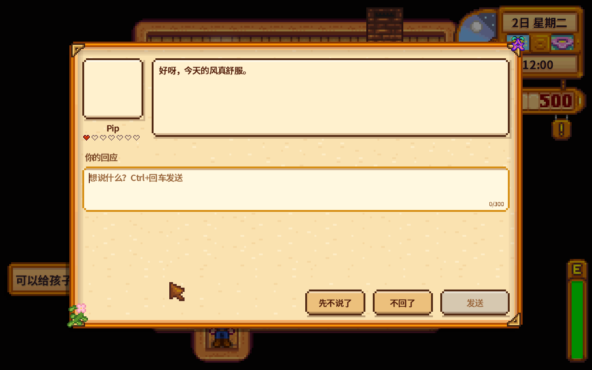

- 每天聊一次，来回的次数和村民一样。
- 手里拿着帽子点孩子，是给孩子戴帽子，不会弹聊天。
- **给孩子写性格**：**设置 → 常用 → 设定 → 村民角色卡**，在“孩子”一栏选你的孩子，写性格、爱好、说话方式，保存后下次聊天就照着来。
- 换成每天只说一句，或者完全用游戏原来的台词：**设置 → 家里 → 孩子 → 孩子说话**。

## 六、孩子离家出走

偶尔（默认每天上午 3% 的机会，同一个孩子至少隔两周）孩子会偷偷跑到农场上躲起来玩。

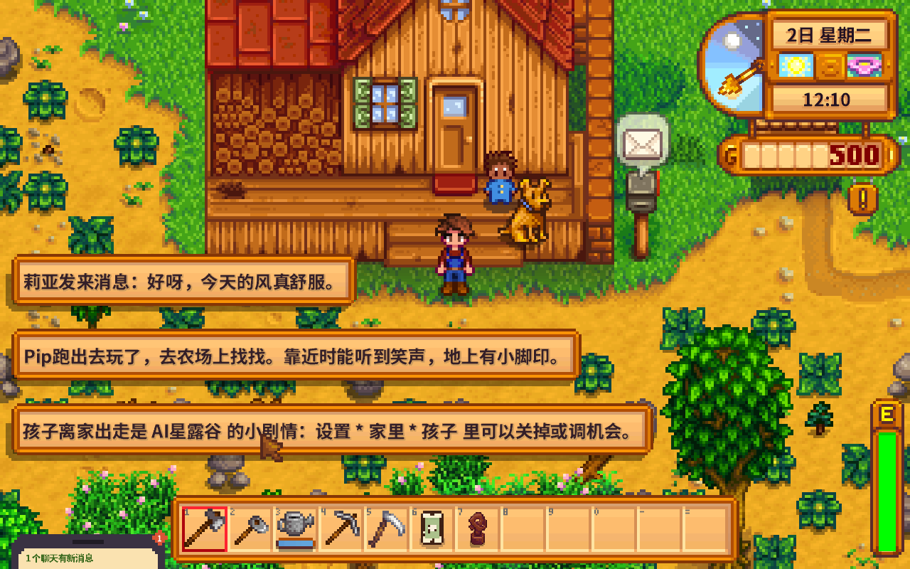

1. **报信**：配偶和你在一起时会走过来告诉你；不在一起时发手机消息。屏幕上也会提示。
2. **找**：孩子躲在离家远一点的树后、灌木边。走近了能听到笑声，头顶冒“嘻嘻”；路上可能掉着孩子的玩具；每过一阵配偶会说个大概方向。
3. **找到了**：点孩子，孩子说一句话，然后回家。找得越快，配偶越高兴。
4. **没找到**：到傍晚 6 点，配偶会自己把孩子找回来，但心情不太好。没有配偶的话，孩子天黑前自己回家。

关掉或调机会：**设置 → 家里 → 孩子 → 孩子离家出走 / 每天跑出去的机会**。

## 七、配偶的一天

婚后配偶每天早上排好今天的安排：浇水、收菜、照顾动物、进鸡舍和温室干活、去镇上找人聊天、用自己的钱买东西、去小超市看店、带孩子在院子里玩。

- 你在农场时能看到 TA 真的走出门去干活；你不在时，TA 在后台做完。
- 收获的东西放进配偶专用的箱子，在手机 **家务安排** 里领取。
- 晚上 TA 会告诉你今天做了什么，第二天也会聊起来。
- 在手机 **家务安排** 里可以看进度、关掉某一项、请 TA 帮忙。聊天里说“帮我喂一下动物”也算数，不收钱。

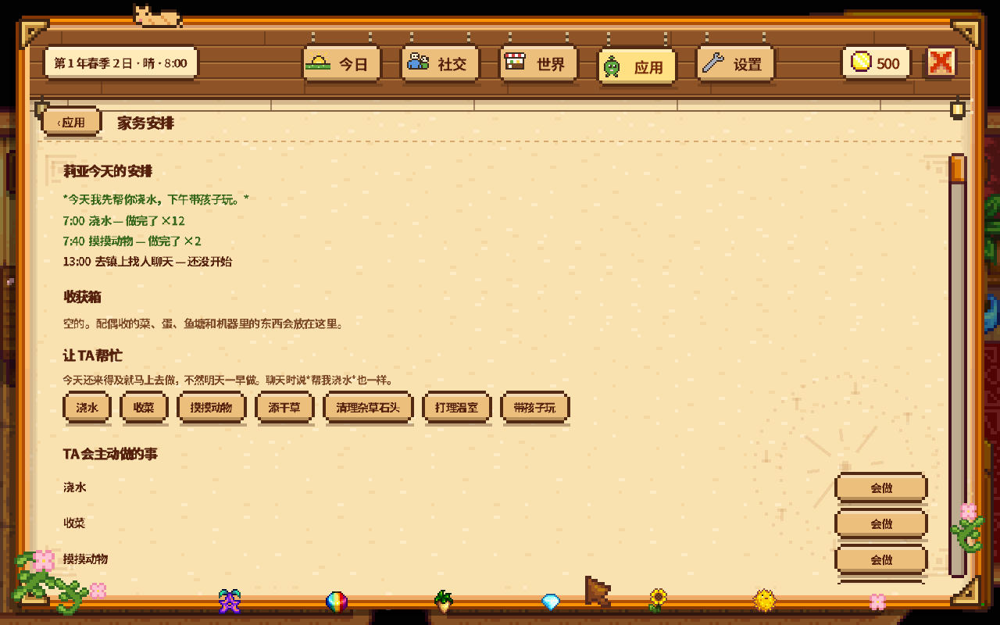

关掉：**设置 → 家里 → 配偶 → 配偶的日常安排**。

---

## 八、常见问题和开关一览

**问：小超市建在哪？**
答：Robin 的木匠铺 → 建造农场建筑 → 农夫小超市，建在你自己的农场上。

**问：顾客怎么一直不来？**
答：看看是不是在营业时间内、货架上有没有货、货是不是过期了。下雨和深夜人少；星级高、贴了海报、吆喝过会多来人。

**问：收银小游戏太麻烦？**
答：设置里关掉“收银小游戏”，或者雇一个收银员。

**问：按住 Alt 没反应？**
答：在 **设置 → 快捷键** 里看“按住点村民 = 游戏原来的互动”是哪个键；可以在 Generic Mod Config Menu 里改。

| 功能 | 在哪里关 |
|---|---|
| 农夫小超市 | 设置 → 小超市 → 农夫小超市 |
| 收银小游戏 | 设置 → 小超市 → 收银小游戏 |
| 和 Pierre、Joja 抢生意 | 设置 → 小超市 → 和 Pierre、Joja 抢生意 |
| 上门理论时动手 | 设置 → 小超市 → 上门理论时可以动手 |
| 亲吻圆盘 | 设置 → 家里 → 配偶 → 点配偶先选聊天还是亲吻 |
| 配偶的日常安排 | 设置 → 家里 → 配偶 → 配偶的日常安排 |
| 我先开口 | 设置 → 常用 → AI → 我先开口 |
| 宠物的心里话 | 设置 → 家里 → 宠物 → 宠物的心里话 |
| 孩子说话 | 设置 → 家里 → 孩子 → 孩子说话 |
| 孩子离家出走 | 设置 → 家里 → 孩子 → 孩子离家出走 |
