# AI星露谷 更新说明

这里按版本记下每次更新玩家能感觉到的变化。每个玩法在哪里关、还有哪些细节，可以看 [新功能指南](新功能指南.md)，游戏里也能查：打开手机 → **使用帮助**。

---

## 0.5.0

这一版加了几样大东西：

- 镇上的人有了自己想做成的事，做成了会请你去看；
- 孩子会长大、去上学；
- 约好的人到点会主动来找你，见了面还陪你走一段；
- 做错事有了越犯越重的后果；
- 联机也能一起玩了。

旧存档直接读就行，不用新开档。

目录：

1. [村民有了自己的人生](#一村民有了自己的人生)
2. [孩子会长大](#二孩子会长大)
3. [约好的人会来找你](#三约好的人会来找你)
4. [做错事有后果](#四做错事有后果)
5. [联机一起玩](#五联机一起玩)
6. [其他改进](#六其他改进)

---

### 一、村民有了自己的人生

镇上 12 位村民各有一件一直想做成的事。同一时间有几位在忙（默认 3 位），一位做成了，再轮到下一位。

#### 他们在忙什么

每件事分三四步，每周可能往前走一步。比如海莉想办摄影展：

1. 先把这些年拍的照片全翻出来，一张张挑；
2. 再去说服刘易斯镇长借广场一天；
3. 然后把照片冲洗出来、钉上相框；
4. 最后在镇广场办起了摄影展。

每走一步，你都会在八卦和周报里听到消息，找他们聊天时他们也会提起。走的快慢看他们心情好不好、有没有朋友帮着，也看你帮没帮忙。

#### 帮一把

走到某一步，村民会托你找样东西，任务日志里能看到。送到了，事情成得更快，结局的信里也会谢谢你。

| 村民 | 想做成的事 | 托你找 |
|---|---|---|
| 海莉 | 办一次自己的摄影展 | 20 块木头（做相框） |
| 山姆 | 让乐队第一次正式登台 | 1 个电池组（音箱烧了） |
| 莉亚 | 开一次个人画展 | 3 块浮木（做画框） |
| 玛鲁 | 做出一台会自己浇水的机器人 | 3 根铜锭（做关节） |
| 潘妮 | 在博物馆给全镇上一堂课 | 2 块石英（上课给大家摸） |
| 阿比盖尔 | 一个人走一趟山那边的远路 | 2 个面包（路上吃，“别告诉我爸”） |
| 潘姆 | 在酒吧办一场卡拉OK之夜 | 3 杯咖啡（润嗓子） |
| 格斯 | 在镇广场办一场美食节 | 5 个鸡蛋（做蛋饼） |
| 林纳斯 | 被镇上的人真正接纳 | 3 个蛤蜊（请邻居吃饭） |
| 艾米丽 | 办一场自己的服装秀 | 1 颗紫水晶（做扣子） |
| 威利 | 办一场全镇的钓鱼大赛 | 20 个鱼饵（发给参赛的人） |
| 罗宾 | 在镇上搭一座花架凉亭 | 5 块硬木（做柱子） |

#### 做成了：请你去看

事情做成的那天，村民会来信请你。信在手机 → 社交 → **信件** 里，写着时间和地点。

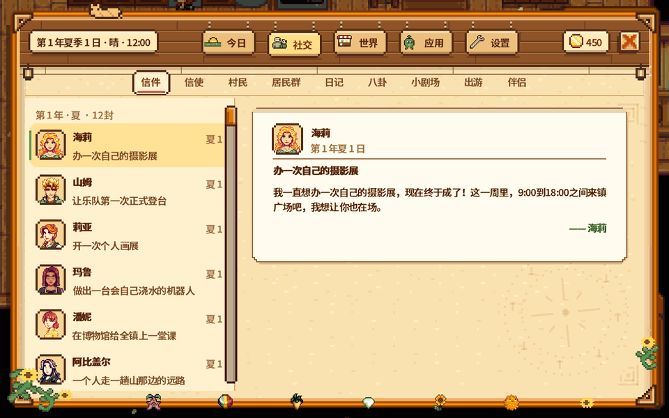

在信上说的**那一周**、**那个时间**走进那个地方，就能看到一段结局：主角和来捧场的朋友站好，场上摆着这件事的道具（照片墙、乐队海报、画架、机器人……），大家一人说几句。台词是 AI 按这一路的经过现写的，每个存档都不一样。

| 村民 | 在哪里 | 什么时间 | 谁来捧场 |
|---|---|---|---|
| 海莉 | 镇广场 | 9:00～18:00 | 艾米丽、亚历克斯 |
| 格斯 | 镇广场 | 9:00～18:00 | 潘姆、皮埃尔、艾米丽 |
| 林纳斯 | 镇广场 | 9:00～18:00 | 刘易斯、玛妮、格斯 |
| 罗宾 | 镇广场 | 9:00～18:00 | 德米特里厄斯、刘易斯、塞巴斯蒂安 |
| 莉亚 | 煤矿森林，莉亚家门口 | 9:00～18:00 | 艾利欧特、罗宾 |
| 玛鲁 | 山上，罗宾家门前 | 9:00～18:00 | 德米特里厄斯、罗宾 |
| 阿比盖尔 | 山上，罗宾家门前 | 9:00～18:00 | 卡洛琳、皮埃尔 |
| 潘妮 | 博物馆 | 9:00～18:00 | 冈瑟、文森特、贾斯 |
| 威利 | 海滩 | 9:00～18:00 | 艾利欧特、潘姆、林纳斯 |
| 山姆 | 星之果实酒吧 | 17:00～24:00 | 塞巴斯蒂安、阿比盖尔、格斯 |
| 潘姆 | 星之果实酒吧 | 17:00～24:00 | 格斯、潘妮、谢恩 |
| 艾米丽 | 星之果实酒吧 | 17:00～24:00 | 海莉、莉亚、格斯 |

12 段结局的样子：

| | |
|---|---|
| 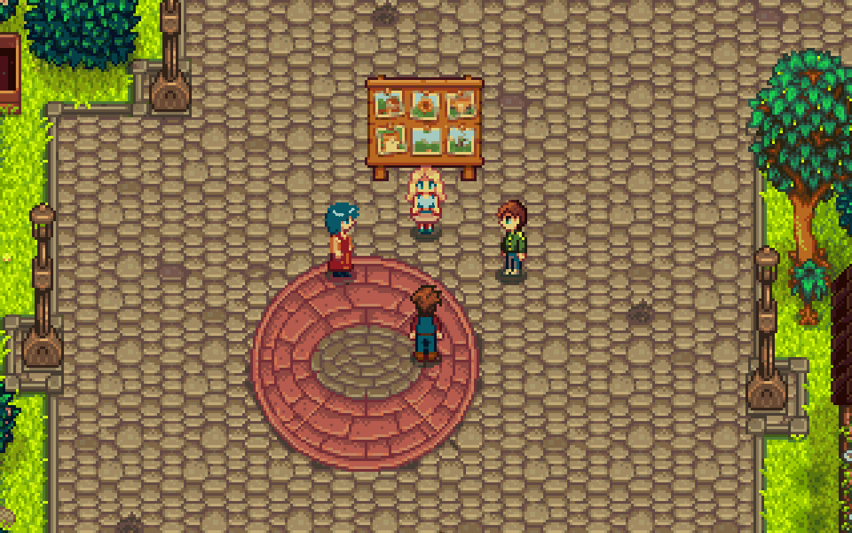 海莉的摄影展：镇广场上立起一面照片墙 | 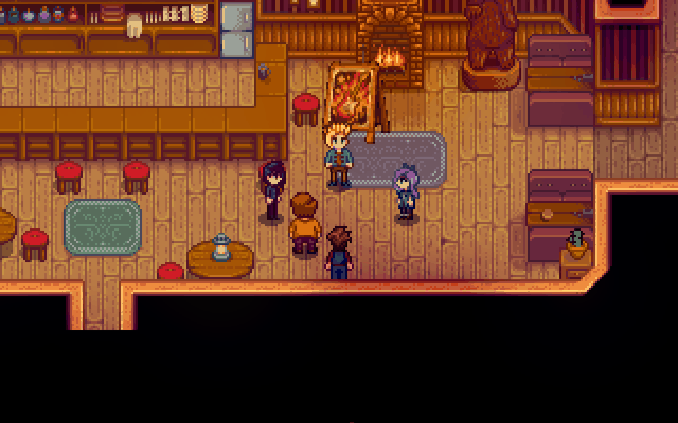 山姆的乐队第一次登台：酒吧里贴着乐队海报 |
| 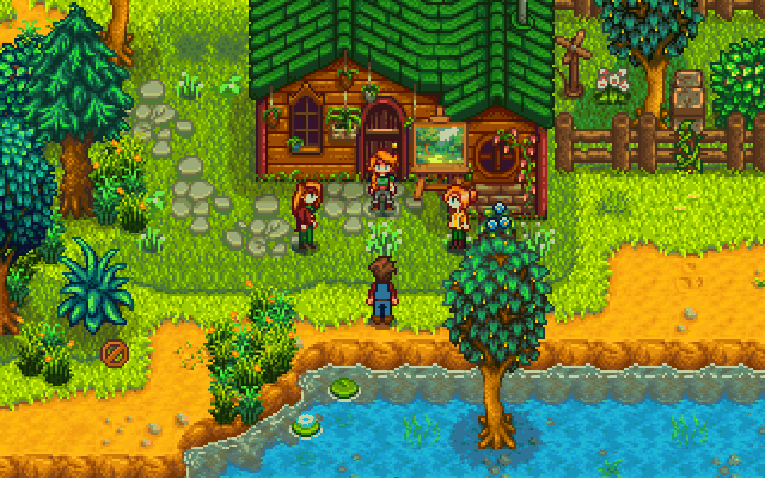 莉亚的画展：家门口支起画架 | 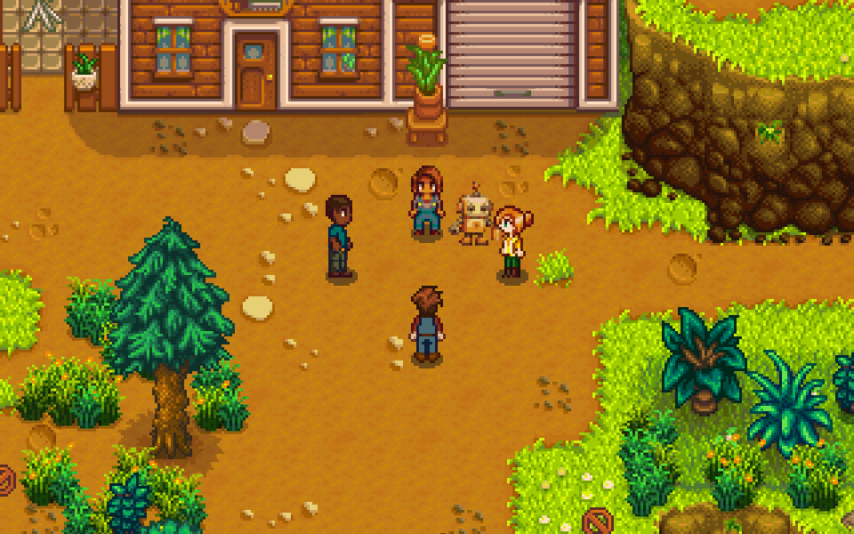 玛鲁的浇水机器人 |
| 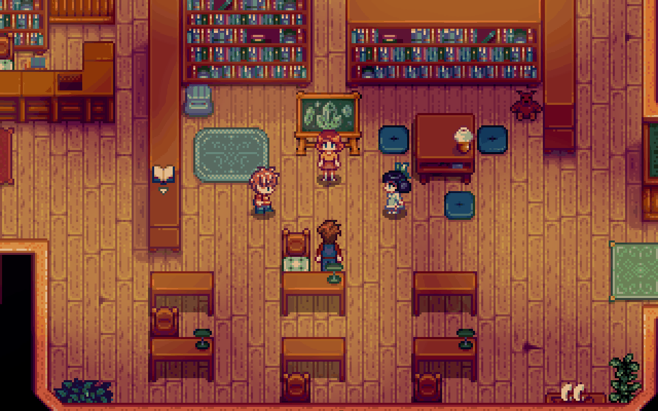 潘妮在博物馆上课：讲台前立着小黑板 | 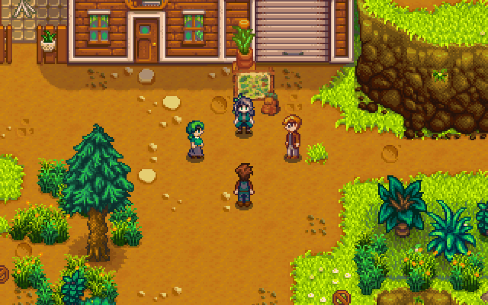 阿比盖尔出发前，摊开一张地图 |
| 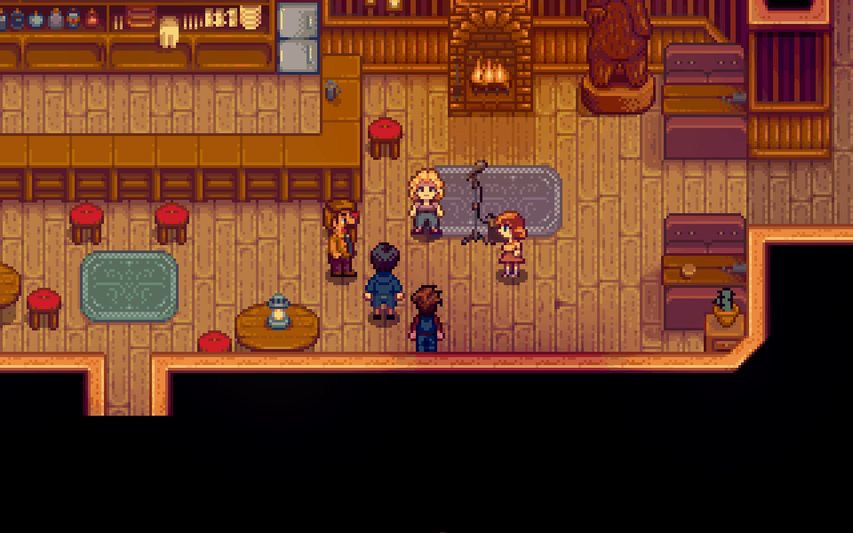 潘姆的卡拉OK之夜 | 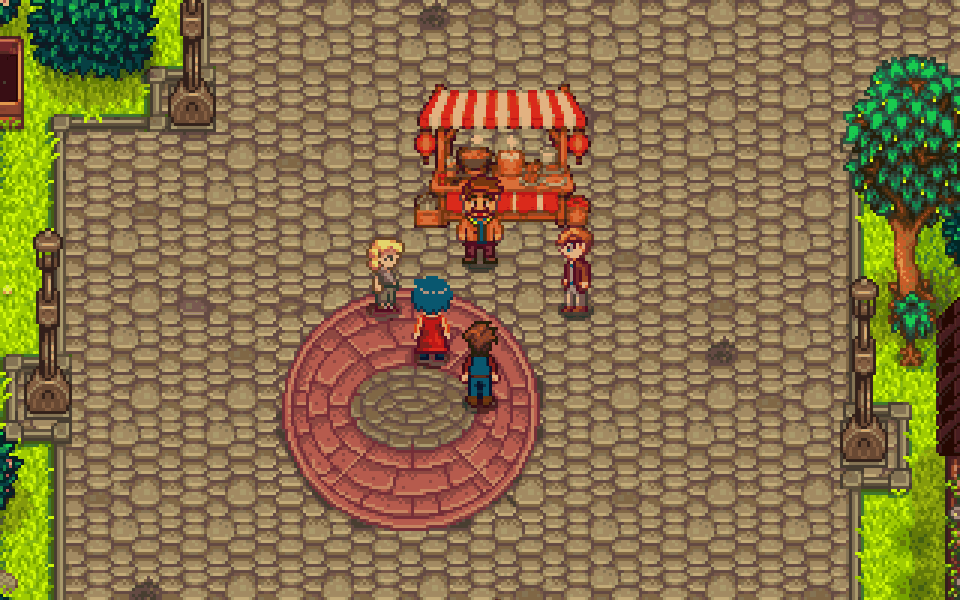 格斯的美食节：广场上搭起小吃摊 |
| 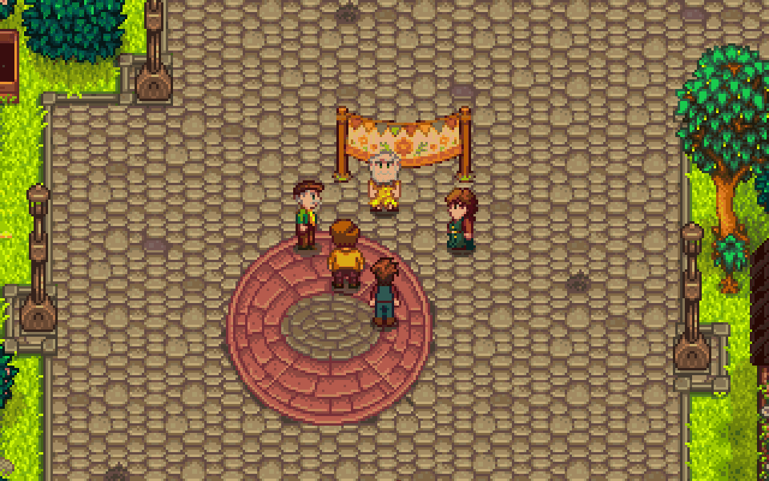 大家为林纳斯拉起欢迎横幅 |  艾米丽的服装秀：酒吧里摆着衣架 |
| 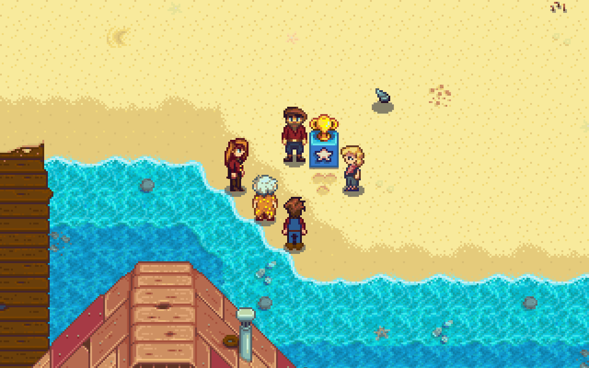 威利的钓鱼大赛：海滩上放着奖杯 | 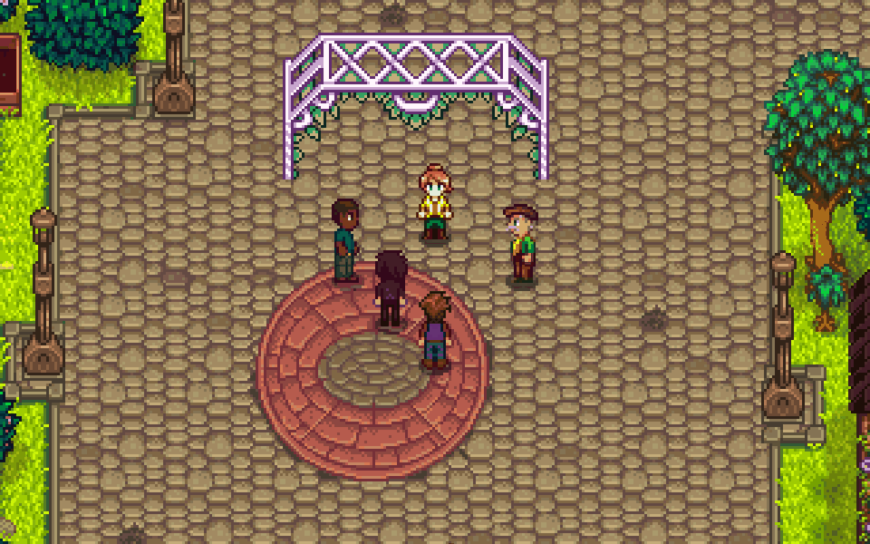 罗宾在镇广场搭起的花架凉亭 |

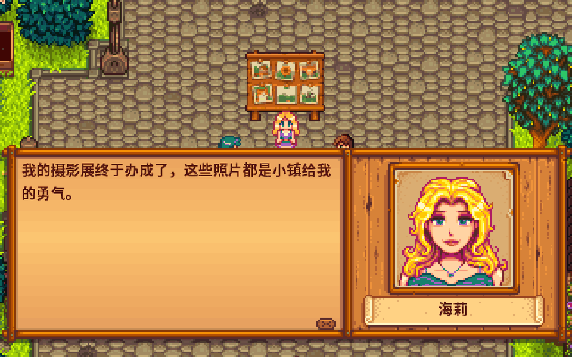

没赶上也没关系，过了那一周，这件事照样算做成了，只是看不到那一段。

#### 日记里多一幅画

做成以后，这位村民的日记（手机 → 社交 → **日记**）里会夹进一幅新画，12 位各一幅：

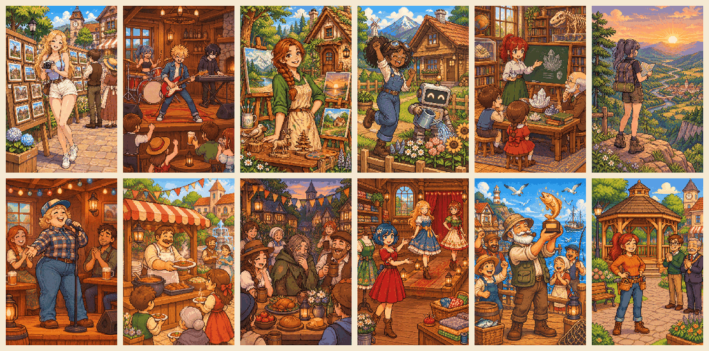

#### 有的人换了工作

几位做成以后会换个活干，聊天时他们会说起新工作，村民账本里的收入也跟着变：

- 海莉：开了个小照相馆，帮镇上的人拍照；
- 山姆：在 Joja 打零工，周末在酒吧驻唱；
- 莉亚：卖画，也接雕刻的订单；
- 潘妮：给孩子上课，每个月去博物馆讲一次。

#### 村民之间也会谈恋爱

暗生好感的两位村民可能开始交往。交往的两个人每周有一个晚上约会，会约在酒吧、河边、海滩或者山里的湖边，要是和你的约见、帮工撞上，就给你让路。

交往久了会订婚，你会收到请帖。一周后在镇广场办婚礼：花拱门、站位都照原版婚礼，刘易斯主持。当天上午九点到下午四点去镇上就能看到。

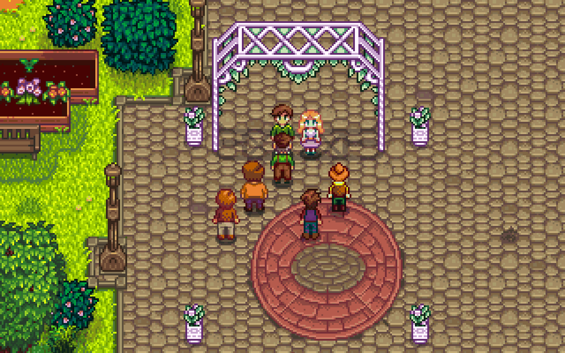

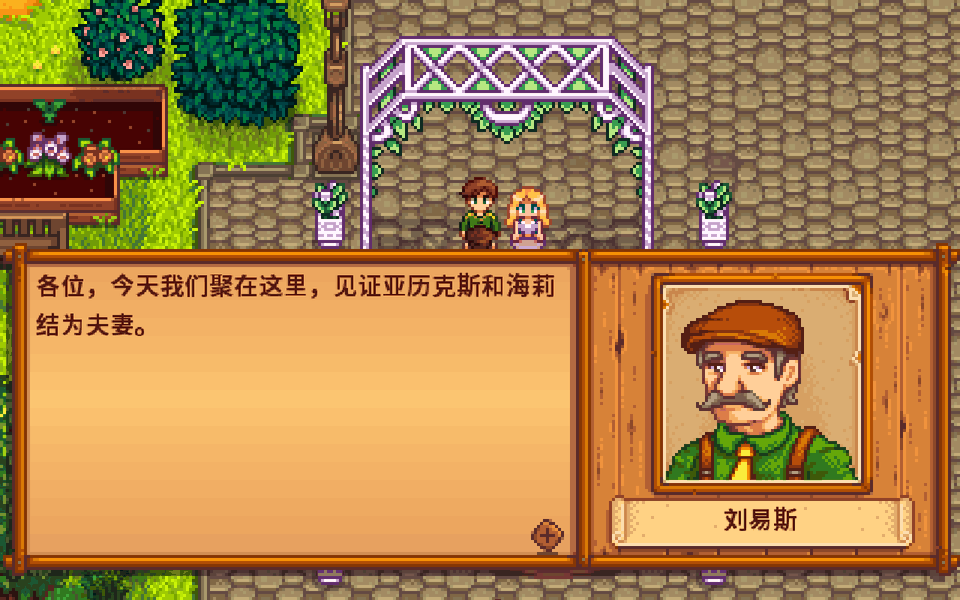

也可能吵架分手。关系网里情侣会画成一对，结了婚的也会进家谱。

你在追求、交往或者已经娶嫁的村民，不会和别人谈；你和一对情侣里的某一位谈起恋爱，那一对就散了。

**在哪里关**：设置 → 镇上的生活 → **村民的人生**。这一页能关掉整个玩法，也能改同时有几位在忙、关掉婚礼、关掉换工作。村民之间谈恋爱还受“村民之间可能产生好感”这个开关管。

---

### 二、孩子会长大

以前孩子学会走路就不再长了。现在孩子会走路以后，默认再过两季到上学的年纪，再过一年成少年。

上图从左往右，每三个一组：幼儿、上学、少年。四组依次是男孩、女孩，深肤色的男孩、女孩。长大后的样子接着原版幼儿的发色和衣服颜色。

#### 长大那天

- 孩子换个样子，第一次见到你会跑过来跟你说一句；
- 配偶会来信；
- 镇上的人也会聊起这件事。

孩子有了自己的头像，四种表情（平常、开心、难过、吃惊）：

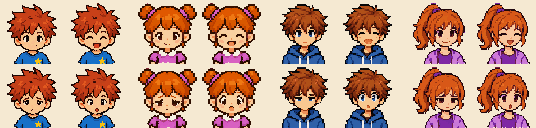

聊天时就画这个头像：

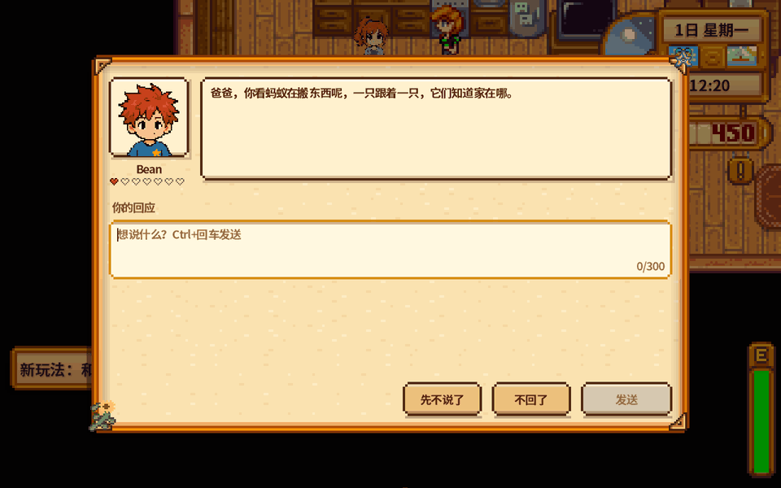

#### 你怎么陪，孩子就长成什么性子

| 平时 | 长成 |
|---|---|
| 常聊天、常陪着玩 | 活泼 |
| 很少理会 | 文静 |
| 常去教室看上课 | 好奇 |
| 离家出走时，每次都很快找到 | 黏人 |
| 跑出去很久才找回来 | 独立、调皮 |

长大那天，AI 会按这些写下孩子现在是什么样子。兄弟姐妹一个一个写，不会写成一模一样。你在角色卡里给孩子写了性格的，以你写的为准。

#### 说话跟着年纪变

- 上学的孩子一句话长一些，会讲学校里的事，知道自己真上过几次课、今天有没有课；
- 少年有自己的态度；
- 都不谈恋爱、不谈钱。

#### 去上学

上学年纪的孩子在佩妮上课的日子，上午去博物馆和贾斯、文森特一起上课，下午两点回家。原版是星期二、三、五上午上课；下雨、过节、9 号和 23 号不上。装了 SVE 也一样，看佩妮那天有没有课。

你去教室看一眼，孩子会记下来。佩妮聊天时也知道这孩子学得怎么样。

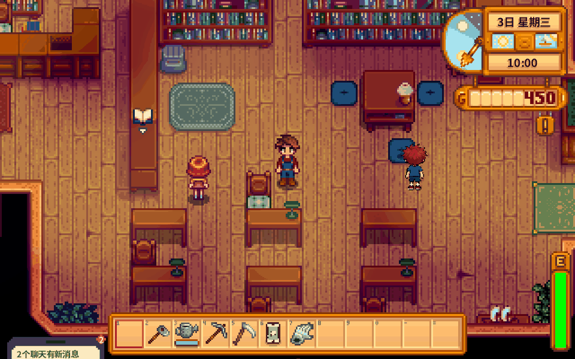

#### 少年

- 周末不下雨时，上午十点到下午四点去镇广场一带逛；
- 配偶带孩子的时候，少年会帮着浇几块地；
- 少年不再离家出走。

**在哪里关**：设置 → 家里 → **孩子**。可以关掉长大，也可以改每一档有多长，一周到一年之间选。

---

### 三、约好的人会来找你

以前约好见面，村民只会在约定地点干站着，你没走到跟前就一直等。现在：

#### 迎上来，先开口

到点后你在同一张地图上，对方看见你会自己走过来，先开口说你们约好的事，接着你可以回话。

#### 进屋找你

过了二十分钟你还没到，人又在约定地点附近的屋里，对方会推门进来找你。比如约在杂货店门口，你在店里挑东西，对方就进店来找：

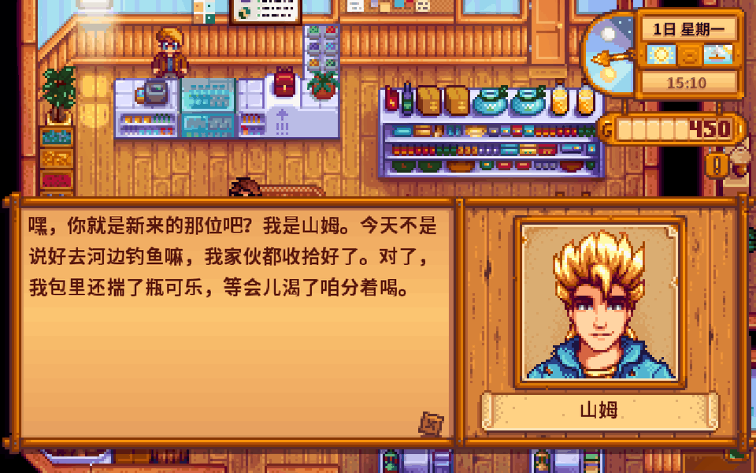

你自己的农舍要 4 颗心以上才进（伴侣、恋人不用），不够熟就提示“在门口等你”。你在矿洞、沙漠这些远的地方，对方不会追过去，照旧在原地等。

#### 陪你走一段

见到以后，对方会跟着你走两小时左右，最晚到晚上十点。你换地图也跟着，到一个新地方偶尔说一句。陪着的时候找对方聊天，对方知道你们正一起逛。

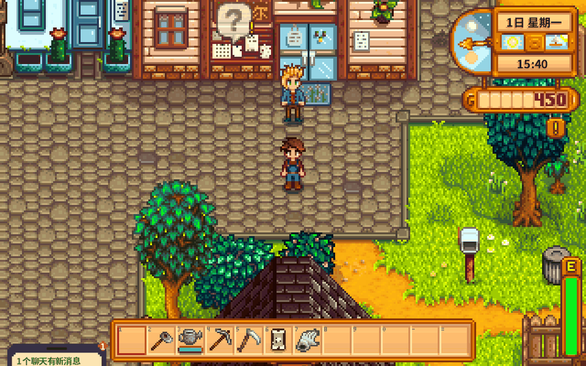

矿洞、赌场、更衣室、岛上这些地方，对方不跟进去，到那儿就道别回家。你走开了看不见对方时，道别的话会弹在屏幕上。

想早点分开：打开手机 → **今天**，“山姆正陪着你”这一行点 **先到这儿吧**。

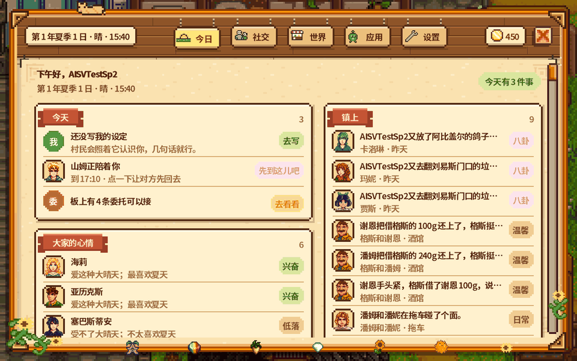

约好了没去，还是算放鸽子。

#### 别的“找上门”也一样

- **收债**：欠钱到期又过了三天还不还，借钱的人会当面来找你要。你在他那张地图上的屋里，他也会进来。一整天没碰上，晚上八点照老办法直接扣钱。
- **帮工**：请来农场帮工的人到了，先走过来打个招呼再干活。你在屋里，就提示他在门口。
- **心事**：村民心里搁着刚看到的事、走过来找你说时，你进了屋也会跟进来，说完从门口出去。

**在哪里关**：设置 → 世界 → **见面后陪你走一段**、**进屋找你**。

---

### 四、做错事有后果

做了对不起人的事，除了原来就有的后果，同一季里犯得越多越重，换季清零。

| 做了什么 | 第一回 | 第二回 | 第三回起 |
|---|---|---|---|
| 放人鸽子（约好了没去） | 对方记成你说话不算话，心情变差 | 传开 | 这一周不肯再和你约 |
| 答应的事没办（托付、请求过期） | 好感掉一点 | 传开，大家说你不靠谱 | 同第二回 |
| 欠钱不还（借款、格斯的赊账到期） | 镇长来信 | 传开 | 两周内谁也不借钱给你，格斯也不让赊账 |
| 在店里动手（上门理论时） | 罚款、好感大降 | 罚款加倍、镇长来信 | 被带走，当天结束 |
| 偷东西被当场抓（装了 Stardew Thief） | 原来的罚款和牢房 | 传开 | 镇长来信 |
| 屡次翻别人家的垃圾桶 | 原版的掉好感 | 主人来信 | 大家给你起外号 |
| 当着恋人、配偶调情 | 对方来质问，伤心好几天 | 同左 | 同左；配偶这几天不帮你干农活 |

传开的事会出现在手机“今天”的“镇上”一栏、八卦和周报里，村民聊天时也会提起。来信在第二天的信箱里，比如屡次翻刘易斯家的垃圾桶：

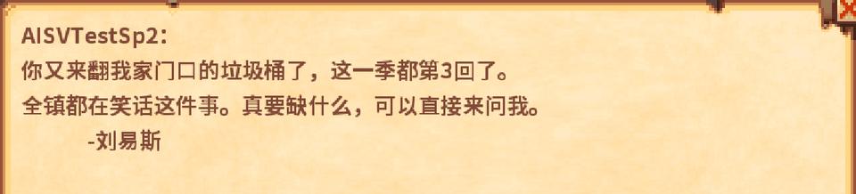

卖赃物被认出来的那一套照旧，现在每次被罚都各来一封信，读档后打开也不会是空的。

**在哪里关**：设置里新加了“**后果**”一页，每一种都能单独关；“屡犯会被带走”也挪到了这一页。

---

### 五、联机一起玩

大家装同一版本的 AI星露谷就行。

- **全村一份**：八卦、关系网、村民的人生、周报、今天的心情、村民账本和委托板，都由房主那边算好发给大家，大家看到的一样。农场帮手和村民聊过的事，晚上也会传成全村的八卦；村民也知道今天别的农夫找他聊过什么。
- **农场帮手能做的**：
  - 和村民聊天；
  - 当面聊天时约村民见面、请村民来农场帮工，帮工的钱从你自己身上付，收拾出来的东西进你自己的箱子；
  - 在手机上接委托、托村民办事、向村民借钱还钱；
  - 结了婚的，配偶每天也会排好自己的安排，收的东西进你自己的收获箱。
- **各算各的**：做错事的罚款、来信、被带走，只落在做事的人身上；分开钱包扣他自己的钱，共用钱包扣大家的钱。信件、日记、村民对你的看法每人一份。
- **帮工更勤快**：以前只要有人在农场上，帮工就一处都不干；现在会替所有人都看不到的地方干活，有人在农场时干得慢一半。
- **版本不一样**：农场帮手会看到提示，他那边的功能只在自己这里用，不和房主同步。
- **还只有房主能用**：农夫小超市、在手机上发消息约村民、居民群里约、孩子离家出走。同一台电脑分屏玩时，第二个画面用不了需要同步的功能。

---

### 六、其他改进

#### 村民说话各有各的味道

以前大家说话像一个模子出来的：开口先寒暄，结尾总问一句“你这两天忙不忙？”。这一版把内置的 35 位原版村民和 12 位 SVE 村民的角色卡都重写了。现在每张卡都有四百多字，写清了这个人的外貌、日常、喜好、心事、小习惯、镇上人怎么看他，以及生人、熟人、很亲近的人面前分别是什么样。每张卡还单独写了“怎么说话”：句子长短、口头禅、什么口气，外加两句示范腔调的例句。

同一个下午在广场碰见，现在大概是这样：

- 塞巴斯蒂安：“天热，别站太阳底下。有事？”
- 乔治：“哼，站这儿挡光了。我这轮椅可不挪。”
- 潘妮：“那个……你要是不赶时间，陪我走一段吧。”
- 帕姆：“小家伙，这鬼天气热得我脑仁疼。”

村民也不再像客服那样夸你“真贴心”、替你总结心情。

想自己改的话，打开 设置 → 常用 → **村民角色卡**，选一位村民，左边就是默认设定。点 **抄进性格栏再改**，设定会进“性格”栏，说话方式会进“说话方式”栏，可以分开改。只改说话方式也行，其余的照旧用默认的。

#### 出了问题先自检

村民不说话、说的话不对劲、某个玩法没反应时，打开 设置 → 常用 → **AI 状态**，点 **自检**。几秒后按钮下面会告诉你几项正常、几项要注意：

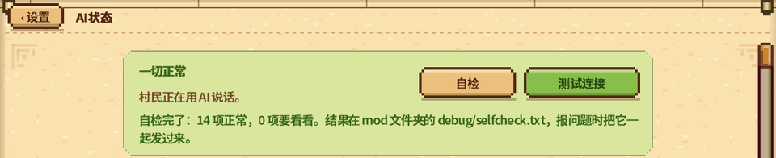

它会看这些：

- AI 能不能来回一次；
- 配置对不对，密钥只显示“已填”；
- 存档数据读不读得出，素材文件齐不齐，各语言缺没缺；
- 和别的 mod 有没有改到同一处；
- 最近有没有 AI 失败。

完整结果在 mod 文件夹的 `debug/selfcheck.txt`，反馈问题时把它和 SMAPI 日志一起发过来。

#### 12 种语言补齐

- 后果、村民的人生、孩子长大、联机这些新内容，之前只有中文，现在都翻译了。
- 葡语、德语、俄语、日语、韩语里，游戏字体画不出的符号和字都换掉了，不会再显示成方块。
- 别的语言下，季节名用游戏自己的译名。
- 德语、俄语的长字不再压字、出框。

#### 修了这些

- 孩子长大后的样子以前太糊，脸都看不清，现在重画得清楚了（上面“孩子会长大”里的图就是新的）。
- 配偶、村民帮工替你收庄稼时，耕种经验被算到了你身上。
- 两个孩子同一天长大时，第二个孩子跑过来说的那句会丢。
- 卖赃物的罚款信，读档后打开是空的。
